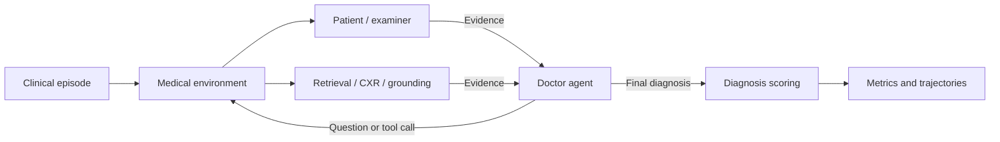

# MedEnv: Scaling Multimodal Virtual Medical Environments for Long-Horizon Diagnosis

**Accepted to MICCAI 2026.**

MedEnv is a multimodal virtual medical environment for multi-turn diagnosis. A doctor agent gathers evidence by interviewing a simulated patient, requesting examinations, retrieving medical knowledge, and inspecting chest X-rays before submitting a diagnosis. This repository provides the data-processing framework, benchmark inference and evaluation code.

[中文说明](README_zh.md) · [Inference guide](docs/RUNNING.md) · [Configuration & customization](docs/CONFIGURATION.md) · [Data format](data/README.md)

## Public release and MIMIC data

We publicly release the **code and documented process used to process MIMIC data**, including database import, diagnosis-window extraction, OSCE case construction, EHR conversion and ICD-stratified sampling. See [`data_process/README.md`](data_process/README.md) for the pipeline, required inputs and commands. Its CXR preprocessing uses report text only; it does not package or copy images, and is not a guarantee of reproducing the exact historical 5,405-case benchmark.

**MIMIC data are restricted-access and are not distributed with this code release.** Raw tables, clinical notes, radiology reports/images, patient/admission/study identifiers, processed OSCE/EHR cases, case-selection manifests and case-level model trajectories must remain private under the applicable PhysioNet access conditions and data-use agreements. De-identification, conversion to JSON or removal of local paths does not make these records public. Users must obtain their own authorized access to [MIMIC-IV](https://physionet.org/content/mimiciv/), [MIMIC-IV-Note](https://physionet.org/content/mimic-iv-note/), [MIMIC-IV-ED](https://physionet.org/content/mimic-iv-ed/) and [MIMIC-CXR](https://physionet.org/content/mimic-cxr/) as required by their inputs. Apache-2.0 applies to the code and does not grant permission to redistribute these datasets.

Keep real inputs, databases and derived outputs outside the checkout. Local `data/bench/`, `data/retrieval/` and `outputs/` are excluded from Git; **Git ignore rules do not exclude them from a manual ZIP, directory upload or file copy**. Publish the reviewed source files only. Public examples in `data/synthetic/` are fictional software fixtures with generated test-pattern images.

`outputs/` can be deleted if the run records are no longer needed; evaluation recreates its output directory. Keep `data/README.md` and `data/synthetic/` for documentation, quick-start checks and offline tests. Move or remove private `data/bench/` and local `data/retrieval/` assets separately: evaluation needs a configured `MEDENV_BENCH_ROOT`, and retrieval needs `RETRIEVAL_INDEX` / `RETRIEVAL_CORPUS` pointing to authorized external assets. See the [local privacy audit](docs/DATA_PRIVACY_AUDIT_zh.md) for the checked scope and findings.

## How it works

Patient and examiner responses use the episode's EHR first, then consult the associated disease knowledge when the record cannot answer a request. The doctor chooses the next action from the available tools; the Judge evaluates the final diagnosis against the reference label.



## Quick start

Use Python 3.11 and a PyTorch installation appropriate for your hardware.

```bash
git clone https://github.com/FanZT6/MedEnv.git
cd MedEnv
python -m venv .venv
source .venv/bin/activate
python -m pip install -e .
cp .env.example .env

# Check the input pipeline with synthetic cases; no model service is needed.
bash scripts/run_all.sh --case_dir data/synthetic --dry_run
```

Set the benchmark path, model paths and endpoints in `.env`, then follow the [service setup](docs/RUNNING.md#3-start-the-model-services). Once the services are ready:

```bash
# Text baseline: 10 cases from with_img/ed_hosp, using CXR reports.
bash scripts/run_bench.sh --cxr_mode reports --max_cases 10 --n_parallel_agents 1

# No-CXR cohort: without_img/hosp_only.
bash scripts/run_bench.sh --no_cxr --max_cases 10 --n_parallel_agents 1

# All cases in all four subsets.
bash scripts/run_all.sh --n_parallel_agents 1
```

For multimodal inference, configure a vision-capable Doctor and matching tokenizer, then pass `--cxr_mode vision`. Both CXR modes expose report information; vision mode also supplies images. See the [inference settings](docs/RUNNING.md#5-run-inference).

Results are written to `outputs/<run>/<subset>/`: `config.json`, `metrics.json` and `trajectories/`. `--max_cases 0` selects the whole subset; `--repeat_k` controls repeated runs.

## Benchmark

| Subset | Cases |
|---|---:|
| `with_img/ed_hosp` | 401 |
| `with_img/hosp_only` | 17 |
| `without_img/ed_hosp` | 1,517 |
| `without_img/hosp_only` | 3,470 |
| **Total** | **5,405** |

Prepared benchmark data are required for evaluation. The repository includes four synthetic cases for checking the interface. See [data access and input structure](data/README.md) to configure your dataset.

## Code layout

```text
medenv/       Benchmark CLI, case loading and metrics
rllm/         Doctor agent, interaction environment, tools and scoring
services/     Retrieval and visual-grounding servers
scripts/      Service launchers, evaluation and result visualization
data_process/ MIMIC processing code and pipeline documentation; no real data
data/         Input format and synthetic cases
docs/         Inference instructions and customization examples
tests/        Offline inference tests
```

To change models, prompts, tool selection or scoring, see the [configuration guide](docs/CONFIGURATION.md), which maps each setting to its file and includes code examples.

## License

Code is licensed under [Apache-2.0](LICENSE). See [NOTICE](NOTICE) for attribution. Datasets and model weights retain their respective access conditions and licenses.
